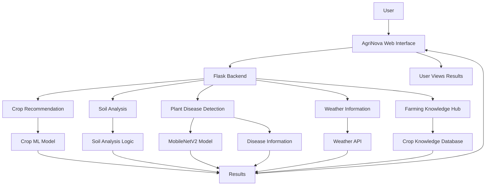

# 🌱 AgriNova – Smart Agriculture Assistant

AgriNova is a smart agriculture web application designed to help farmers make informed farming decisions using Machine Learning, Deep Learning, and real-time weather information.

The platform combines crop recommendation, soil analysis, plant disease detection, weather insights, and farming knowledge in one place.

## 🚀 Features

### 1. Crop Recommendation
- Recommends suitable crops based on soil and environmental parameters.
- Uses Nitrogen (N), Phosphorus (P), Potassium (K), temperature, humidity, pH, and rainfall.
- Uses a Machine Learning classification model.

### 2. Soil Analysis
- Accepts soil nutrient values and pH.
- Analyzes soil conditions.
- Provides general soil improvement suggestions.

### 3. Plant Disease Detection
- Allows users to upload plant leaf images.
- Uses a Deep Learning model based on MobileNetV2.
- Supports 38 plant disease and healthy-leaf classes.
- Displays predicted disease, confidence score, symptoms, care, and prevention information.
- Achieved 88.29% validation accuracy during model evaluation.

### 4. Weather Information
- Provides current weather information.
- Displays a five-day weather forecast.
- Uses weather API integration to retrieve weather data.

### 5. Farming Knowledge Hub
- Provides farming information for Rice, Wheat, Maize, Tomato, and Potato.
- Includes soil, irrigation, fertilizer, seasonal, and cultivation tips.

## 🏗️ System Architecture


## 🛠️ Tech Stack

| Category | Technologies |
|---|---|
| Programming Language | Python |
| Frontend | HTML, CSS |
| Backend | Flask |
| Machine Learning | Scikit-learn |
| Deep Learning | PyTorch, MobileNetV2 |
| Data Processing | NumPy, Pandas |
| Image Processing | Pillow |
| Weather Integration | OpenWeatherMap API |
| Version Control | Git and GitHub |

## 📁 Project Structure

```text
AgriNova/
│
├── app.py
├── src/
│   ├── disease_prediction.py
│   ├── disease_info.py
│   ├── soil_analysis.py
│   ├── weather.py
│   └── knowledge_hub.py
│
├── models/
│   ├── crop_model.pkl
│   ├── plant_disease_mobilenet.pth
│   └── disease_classes.json
│
├── templates/
├── static/
├── .env
├── .gitignore
└── README.md
```

## ⚙️ Installation and Setup

### 1. Clone the Repository

```bash
git clone https://github.com/gauri06srivastava-create/AgriNova.git
cd AgriNova
```

### 2. Create a Virtual Environment

```bash
python -m venv disease_env
```

### 3. Activate the Environment (Windows)

```powershell
.\disease_env\Scripts\Activate.ps1
```

### 4. Install Dependencies

```bash
pip install flask numpy pandas scikit-learn requests python-dotenv torch torchvision pillow
```

### 5. Configure Environment Variables

Create a `.env` file in the project root:

```env
WEATHER_API_KEY=your_api_key_here
```

Replace the placeholder with your own weather API key.

### 6. Run the Application

```bash
python app.py
```

Open your browser and visit:

http://127.0.0.1:5000/

## 🧠 Machine Learning Model

AgriNova uses machine learning for crop recommendation and deep learning for plant disease classification.

The plant disease detection module uses MobileNetV2 transfer learning and was evaluated on a validation dataset.

**Validation Accuracy: 88.29%**

Note: Validation accuracy is not equivalent to real-world field accuracy. Performance may vary with lighting, image quality, and actual field conditions.

## 🔮 Future Scope

- Multilingual support for farmers.
- Regional crop recommendations.
- More plant disease categories and field-image testing.
- Soil and crop analytics dashboard.
- Personalized farming recommendations.
- Mobile application integration.

## 👩‍💻 Developer

**Gauri Srivastava**

B.Tech – Computer Science and Artificial Intelligence

GitHub: https://github.com/gauri06srivastava-create

---

*AgriNova – Empowering Smarter Farming Through Technology.* 🌱